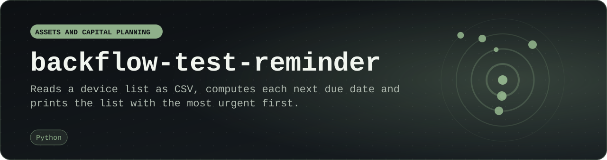
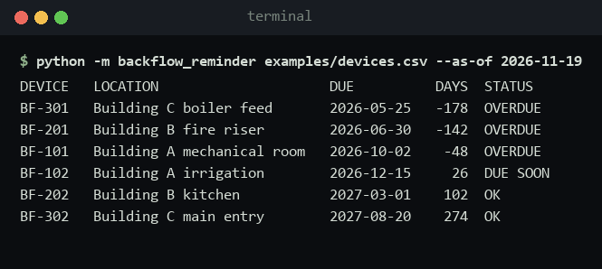

<p align="center"></p>

# backflow-test-reminder

[](https://github.com/yassine2med/backflow-test-reminder/actions/workflows/ci.yml)  

Backflow preventers on fire risers, irrigation and boiler feeds need a certified test on a fixed cycle, usually yearly. Missed tests are a compliance finding and are easy to lose in a spreadsheet. This tool reads a device list as CSV, computes each next due date and prints the list with the most urgent first. It exits with code 1 when any device is overdue, so a scheduled job can alert on it.



## What it is for

Backflow preventers on fire risers, irrigation and boiler feeds need a certified test on a fixed cycle, and a missed test is a compliance finding. Facility coordinators, building managers and safety officers use this tool to keep that cycle visible. They get every device sorted by days left, and an exit code a scheduled job can use to alert when any test is overdue.

## Install

```bash
git clone <repo-url> backflow-test-reminder
cd backflow-test-reminder
pip install -e .
```

## How to use

| I want to | Command |
|---|---|
| List devices by urgency as of today | `python -m backflow_reminder examples/devices.csv` |
| Fix the date used for the check so results repeat | `python -m backflow_reminder examples/devices.csv --as-of 2026-11-19` |
| Change how many days ahead counts as DUE SOON (default 30) | `python -m backflow_reminder examples/devices.csv --warn-days 60` |
| Show help | `python -m backflow_reminder --help` |

Exit code 0 means none overdue, 1 means at least one overdue, 2 means bad input.

Example:

```bash
python -m backflow_reminder examples/devices.csv --as-of 2026-11-19
```

Output:

```text
DEVICE   LOCATION                     DUE          DAYS  STATUS
BF-301   Building C boiler feed       2026-05-25   -178  OVERDUE
BF-201   Building B fire riser        2026-06-30   -142  OVERDUE
BF-101   Building A mechanical room   2026-10-02    -48  OVERDUE
BF-102   Building A irrigation        2026-12-15     26  DUE SOON
BF-202   Building B kitchen           2027-03-01    102  OK
BF-302   Building C main entry        2027-08-20    274  OK
```

## How it works

- Reads columns device_id, location, last_test_date and optional interval_months (default 12) and vendor.
- Due date is the last test date plus the interval in whole months. A day that does not exist in the target month (Feb 29 plus 12 months) moves to the last day of that month.
- Days left is due date minus the as-of date. Below zero is OVERDUE. Zero up to --warn-days (default 30) is DUE SOON. Anything later is OK.
- Results are sorted by days left.
- Exit code 0 means none overdue, 1 means at least one overdue, 2 means bad input.

## Limits

It does not send email or calendar invites. It does not know local code, so the interval is whatever the CSV says. Dates must be ISO format (YYYY-MM-DD).

## Tests

```bash
pip install pytest
python -m pytest -q
```

## License

MIT. Copyright 2026 Yassine Emhamed.
